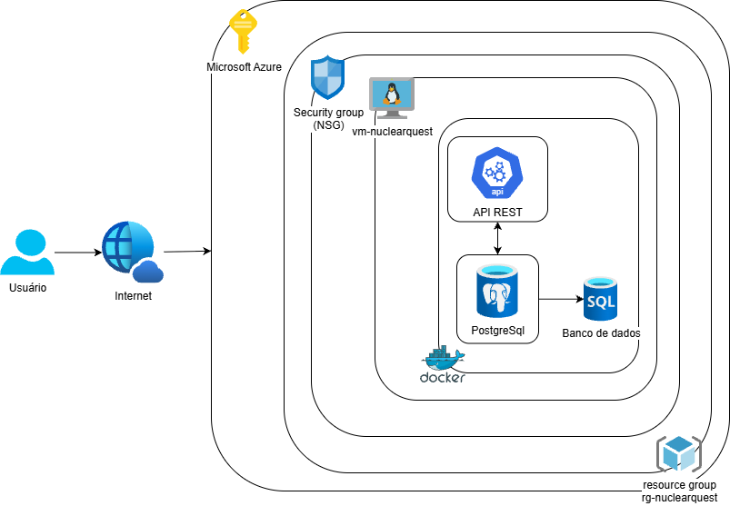

# NuclearQuest

**Challenge FIAP – AMAZUL**

## Integrantes do grupo

- André Souza Matsuda – RM 566733
- Guilherme Barca – RM 568517
- Guilherme Oliveira – RM 566842
- Kaliel Conceição – RM 567587
- Paulo Henrique Muniz Diedrich – RM 567618

## Obs: Por um erro, o projeto foi feito com base na v1 da sprint, contendo docker compose, .yaml e persistência de memória, espero que não atrapalhe a nota e desde já agradecido pela compreensão

## Sobre o projeto

O NuclearQuest é uma API REST desenvolvida em Java com Spring Boot, voltada para uma plataforma educacional de perguntas e respostas sobre tecnologia nuclear.

Este repositório apresenta a implementação da solução utilizando Docker, Docker Compose e Microsoft Azure, permitindo executar a aplicação e seu banco de dados em containers hospedados em uma máquina virtual na nuvem.

## Como Docker e Cloud Computing são utilizados na solução?

O Docker permite empacotar a aplicação e suas dependências em containers, garantindo maior consistência entre os ambientes de desenvolvimento e execução.

O Docker Compose permite gerenciar os serviços da aplicação, incluindo a API e o banco de dados PostgreSQL, além de configurar a comunicação entre eles, as portas e o armazenamento persistente.

O Cloud Computing permite hospedar esses serviços em uma infraestrutura disponibilizada pela Microsoft Azure, possibilitando o acesso remoto à aplicação pela internet.

## Arquitetura da solução

A solução é composta por dois containers Docker:

- **API:** aplicação Java com Spring Boot, responsável pelas operações e regras de negócio.
- **Banco de dados:** PostgreSQL, responsável pelo armazenamento das informações.

Os containers se comunicam por meio de uma rede Docker bridge criada pelo Docker Compose, denominada `nuclearquest-network`.

O banco de dados utiliza um volume nomeado (`nuclearquest-data`), garantindo a persistência dos registros mesmo após a remoção e recriação dos containers.

A aplicação está hospedada em uma máquina virtual Ubuntu 24.04 na Microsoft Azure, com acesso externo pela porta 8080. A porta 5432 do PostgreSQL permanece disponível apenas internamente na rede Docker.



## Tecnologias utilizadas e versões

| Tecnologia | Versão / Configuração |
|---|---|
| Java | 21 |
| Spring Boot | 4.0.5 |
| Spring Data JPA | Utilizado no projeto |
| Maven | 3.9 (imagem de build) |
| PostgreSQL | 17 |
| Docker Engine | Consultar versão instalada na VM |
| Docker Compose | 2.40.3 |
| Microsoft Azure | Azure CLI (versão instalada na máquina de provisionamento) |
| Sistema operacional da VM | Ubuntu 24.04 |
| Imagem de runtime Java | Eclipse Temurin 21 JRE Alpine |

**Observação:** as versões do Docker Engine e do Azure CLI devem ser registradas conforme os resultados dos comandos `docker --version` e `az version` nos respectivos ambientes.

## Configuração das variáveis de ambiente

As credenciais de conexão com o banco de dados são definidas por variáveis de ambiente carregadas pelo Docker Compose a partir do arquivo `.env`.

O arquivo `.env` não deve ser enviado ao GitHub, pois pode conter credenciais. O repositório disponibiliza o arquivo `.env.example` como modelo de configuração.

Na raiz do projeto, crie um arquivo chamado `.env` com o seguinte conteúdo:

```env
DB_USER=nuclearquest
DB_PASSWORD=sua_senha
```

Utilize as mesmas credenciais configuradas para o banco de dados PostgreSQL.

## Executando com Docker Compose

Na raiz do repositório, execute:

### Construir e iniciar os serviços

```bash
docker compose up -d --build
```

### Verificar os containers

```bash
docker compose ps
```

### Consultar os logs

```bash
docker compose logs -f
```

### Parar os serviços

```bash
docker compose down
```

**Importante:** o comando `docker compose down` não remove o volume de dados. Para preservar os registros do banco, não utilize a opção `-v`.

## Configurações dos serviços

| Serviço | Configuração |
|---|---|
| API | Porta 8080 |
| PostgreSQL | Porta interna 5432 |
| Banco de dados | nuclearquest |
| Usuário do banco | nuclearquest |
| Rede Docker | nuclearquest-network |
| Volume persistente | nuclearquest-data |

A API utiliza o endereço `db:5432` para se comunicar com o PostgreSQL dentro da rede Docker.

## Banco de dados e dados de teste

O script SQL com os registros de teste está localizado em:

`NuclearQuest/src/main/resources/data.sql`

Após iniciar os containers, execute os comandos abaixo na raiz do projeto para inserir os dados:

```bash
docker cp NuclearQuest/src/main/resources/data.sql nuclearquest-db:/tmp/data.sql
```

```bash
docker compose exec db psql -U nuclearquest -d nuclearquest -f /tmp/data.sql
```

O script insere registros de categorias, usuários, perguntas, alternativas e respostas de usuários.

## API e operações CRUD

A API disponibiliza operações CRUD para o recurso de perguntas:

| Operação | Método | Endpoint |
|---|---|---|
| Criar pergunta | POST | `/perguntas` |
| Listar perguntas | GET | `/perguntas` |
| Consultar pergunta por ID | GET | `/perguntas/{id}` |
| Atualizar pergunta | PUT | `/perguntas/{id}` |
| Excluir pergunta | DELETE | `/perguntas/{id}` |

A documentação interativa da API é disponibilizada pelo Swagger.

**Execução local:**

`http://localhost:8080/swagger-ui/index.html`

**Execução na Azure:**

`http://IP_PUBLICO_DA_VM:8080/swagger-ui/index.html`

Os testes de CRUD devem ser realizados pela API, utilizando os endpoints disponibilizados pelo Swagger.

## Provisionamento na Microsoft Azure

A infraestrutura foi provisionada utilizando Azure CLI.

### Configurações da infraestrutura

| Recurso | Configuração |
|---|---|
| Resource Group | rg-nuclearquest |
| Região | Brazil South |
| Máquina virtual | vm-nuclearquest |
| Sistema operacional | Ubuntu 24.04 |
| Tamanho | Standard_D2s_v4 |
| Usuário administrativo | azureuser |
| Porta da aplicação | 8080 |
| Porta SSH | 22 |

### Provisionar a infraestrutura

O script de provisionamento está disponível em:

`azure/script.sh`

Para executá-lo em um ambiente com Azure CLI instalado e autenticado em uma assinatura com permissões para criar recursos:

```bash
chmod +x azure/script.sh
./azure/script.sh
```

O script cria o Resource Group, provisiona a máquina virtual, configura a regra de acesso SSH, libera a porta 8080 e apresenta o endereço IP público da VM.

### Instalação do Docker e Docker Compose na VM

Após acessar a máquina virtual Ubuntu 24.04 por SSH, atualize os pacotes:

```bash
sudo apt update
```

Instale o Docker e o Docker Compose:

```bash
sudo apt install docker.io docker-compose-v2 -y
```

Configure o usuário para executar comandos Docker sem precisar utilizar `sudo`:

```bash
sudo usermod -aG docker $USER
```

Atualize a sessão do grupo:

```bash
newgrp docker
```

Verifique as instalações:

```bash
docker --version
docker compose version
```

### Executar a aplicação na VM Azure

Após instalar as ferramentas, clone o repositório:

```bash
git clone https://github.com/DiedrichPaulo/Sprint-Amazul-DevOps.git
```

Entre na pasta do projeto:

```bash
cd Sprint-Amazul-DevOps
```

Crie o arquivo `.env` com as credenciais do PostgreSQL, conforme explicado na seção Configuração das variáveis de ambiente.

Inicie os serviços:

```bash
docker compose up -d --build
```

Verifique o estado dos containers:

```bash
docker compose ps
```

Insira os dados de teste utilizando os comandos da seção Banco de dados e dados de teste.

A aplicação poderá ser acessada externamente pelo endereço:

`http://IP_PUBLICO_DA_VM:8080/swagger-ui/index.html`

## Persistência dos dados

A persistência é realizada por meio do volume Docker `nuclearquest-data`, associado ao serviço PostgreSQL.

Ao executar:

```bash
docker compose down
```

E posteriormente:

```bash
docker compose up -d
```

Os containers são recriados, mas os dados permanecem armazenados no volume.

Dessa forma, o banco de dados mantém seus registros mesmo após a recriação dos containers.

